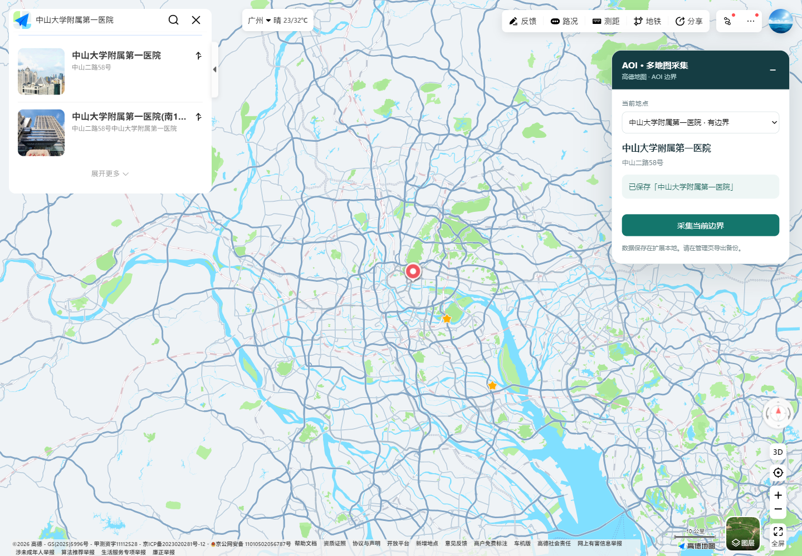

# AOI 多地图采集 · 2.0

从高德、百度地图正常网页操作中收集来源边界，统一预览、保存和导出。腾讯目前为实验支持，只记录地点信息，不将包围框伪装成 AOI。

基于 [eqeqeqr/aoiCollector](https://github.com/eqeqeqr/aoiCollector) 改造，保留原提交历史。来源及许可情况见 [THIRD_PARTY_NOTICES.md](THIRD_PARTY_NOTICES.md)。


## 支持范围

| 平台 | 当前能力 | 说明 |
|---|---|---|
| 高德地图 | 已验证新版网页来源边界采集 | 医院样例 44 点；未返回边界时不自动采集其他地点 |
| 百度地图 | 已验证来源边界采集 | 校园、医院、园区三组来源样例；保留精确性标记，不混用楼栋轮廓 |
| 腾讯地图 | 实验性地点记录 | 仅输出 Point；两点包围框不会作为 Polygon 导出 |

两种独立运行方式共用解析、投影、质量提示和管理界面：

| 方式 | 安装条件 | 保存与导出 |
|---|---|---|
| Chrome / Edge 扩展 | Chromium 111+，加载已解压扩展 | IndexedDB；GeoJSON、CSV、完整 JSON 备份 |
| 本地 Web | Python 3.10+，Edge / Chrome / Chromium | SQLite、GeoJSON、CSV、SHP 套件和原始来源记录 |

所有坐标导出使用 WGS-84 的近似转换结果，不作为测绘精度承诺。原始几何和源坐标系保留在完整备份中。

## 浏览器扩展（优先推荐）

1. 下载源码或扩展包并解压。
2. 打开 `edge://extensions/` 或 `chrome://extensions/`，开启开发者模式。
3. 选择“加载已解压的扩展”，选中 `aoiCollectorJs` 文件夹。
4. 刷新已打开的地图页面。在地图中正常搜索，再点击具体地点。
5. 在右侧浮窗确认名称、来源和质量提示，点击“采集当前边界”。腾讯对应按钮为“保存地点（无边界）”。
6. 点击扩展图标，打开管理页进行预览、导出或完整备份。




没有返回边界时保存按钮不可用，不会自动改采另一个有边界的地点。多个搜索结果可通过浮窗下拉框明确选择；点击百度或高德具体地点时，按地点 ID 更新选择。

浏览器本地数据库在卸载扩展时会删除，且不属于浏览器同步内容。先导出“完整备份”，以后可通过“恢复备份”导入。GeoJSON/CSV 用于分析，完整备份用于保留原始来源。

原版 v1 扩展的 `aoi_collector/aois` 会迁移到 v2 的 `records`。旧对象仓库不会删除；无法转换的记录会在管理页提示。若浏览器为不同安装路径分配了新的扩展 ID，将不会自动访问旧扩展的数据，请保留原扩展并先备份。

## 本地 Web

Windows 推荐在 D 盘项目目录运行：

```powershell
.\start.ps1
```

打开 `http://127.0.0.1:9224/`。点击地图卡片的“打开地图”，会启动独立的受控浏览器。搜索、点击地点后，在浮窗中保存；回到工作台点“刷新”查看。浏览器在后台回传保存结果，不反复切换用户标签页，也不要求地图页面向本地服务发起跨域请求。

可指定端口和临时目录：

```powershell
.\start.ps1 -Port 9224 -TempDir D:\AOI-Temp
```

启动脚本将 Python 依赖缓存、浏览器配置和驱动缓存放入指定数据盘目录。当前任务运行所用的全部临时文件位于 Codex 的 D 盘 tmp 目录；不随源码或安装包发布。

其他系统或手动启动：

```bash
python -m venv .venv
# 激活虚拟环境后
pip install -r requirements.txt
# 可通过 AOI_TEMP_DIR 指定临时目录，AOI_DATA_DIR 指定数据目录
python app.py
```

应用仅监听 `127.0.0.1`。不要将其作为公网服务部署。浏览器选择可通过 `AOI_BROWSER_BINARY` 配置；独立配置目录可通过 `AOI_BROWSER_PROFILE` 指定。不要同时让两个浏览器进程占用同一配置目录。

### 文件与旧数据

每个记录以“来源平台 + 地点 ID”识别；文件目录使用 ID 摘要，同名地点不会覆盖。再次采集同一 ID 会更新当前记录，同时保留上一份文件版本。

```text
output/
  baidu/
    <记录ID摘要>/
      <版本ID>/
        boundary.shp / .shx / .dbf / .prj / .cpg
        boundary.geojson
        record.json
        说明.txt
```

旧版 `aoi.sqlite` 中的 `aoi` 表会迁移到新的 `records` 表，旧表和旧文件保留。旧记录的中心坐标会按旧版原始 GCJ-02 语义转换，并提示核实。迁移失败会显示提示，不静默删除。

Web 中删除是逻辑删除，磁盘历史文件保留；管理页仅展示当前未删除记录。扩展中的删除会移除该记录，请先备份。

SHP 外环、孔洞的方向按 Shapefile 规范输出，并附 UTF-8 编码文件；GeoJSON 保持闭合环和相应的环方向。腾讯记录输出 Point 类型的 SHP/GeoJSON，不混入 AOI 面。

## 来源质量与限制

- 高德中山一院在新版网页实际返回 44 点来源边界，已通过真实扩展保存、同名来源隔离和 SHP 回归。
- 百度三个已验证样例分别包含 855、53、28 个点（含闭合点）；原生 BD09MC 和投影后的 BD09LL 均通过几何检查。
- 深圳湾科技生态园来源 `is_precise=0`，界面会提示非精确，导出和备份保留该标记。几何有效不代表现实边界精度或完整性。
- 当前百度编码适配已验证的单环 `4|范围|1-坐标串;`。未验证的多环编码会明确拒绝，不猜测孔洞或拼成近似面。规范化数据与导出层支持经过校验的 Polygon/MultiPolygon 及孔洞。
- 高德、百度可能出现登录或安全验证，需要在原网页手动完成。没有自动解验证码、补签名、重放地图请求或保证任意地点都存在 AOI。
- 腾讯来源和分类编码独立保留，不套用高德分类。高德内置分类映射及扩展中的可选 Excel 分类更新保留。
- 预览使用本地随附 Leaflet 和在线 OpenStreetMap 底图。底图受网络影响时会提示；已保存边界的预览与导出仍可用。


## 验证与开发

```bash
npm ci --ignore-scripts
npm test
pip install -r requirements-dev.txt
python -m pytest -q
```

当前验证包括：真实高德、百度来源样例、JS/Python 坐标一致性、fetch 原 Promise/响应保留、孔洞与多面、来源匹配、旧库迁移、同名隔离、失败保护、SHP/GeoJSON 文件核对、本地 API 的跨站修改限制。

发布包可在暂存源码后运行 `python scripts/package_release.py` 生成，包含扩展包、Web 源码包与 SHA-256 校验值。

详细区分自动回归、真实页面操作和记录重放的结果见 [验证记录](docs/VALIDATION.md)。GitHub Actions 会运行 Node 与 Python 回归；它不替代地图网页的在线验收。

主要结构：

```text
aoiCollectorJs/
  core.js             # 三平台载荷、坐标和几何规范
  hook.js             # MAIN 环境的被动 fetch/XHR 捕获
  panel.js            # 扩展 / Web 共用采集浮窗
  background.js       # 扩展存储、迁移和消息校验
  manager.*           # 扩展 / Web 共用管理和预览
  vendor/leaflet/      # 本地随附地图预览依赖及许可
geometry.py           # Web 坐标和几何校验（与 JS 回归核对）
storage.py            # SQLite、旧库迁移、版本化文件与导出
browser.py            # 受控浏览器与不抢焦点的本地保存桥接
app.py                # 本地 Web 入口
start.ps1             # Windows 启动与数据盘缓存设置
tests/                # 解析、存储、迁移和导出验证
```
