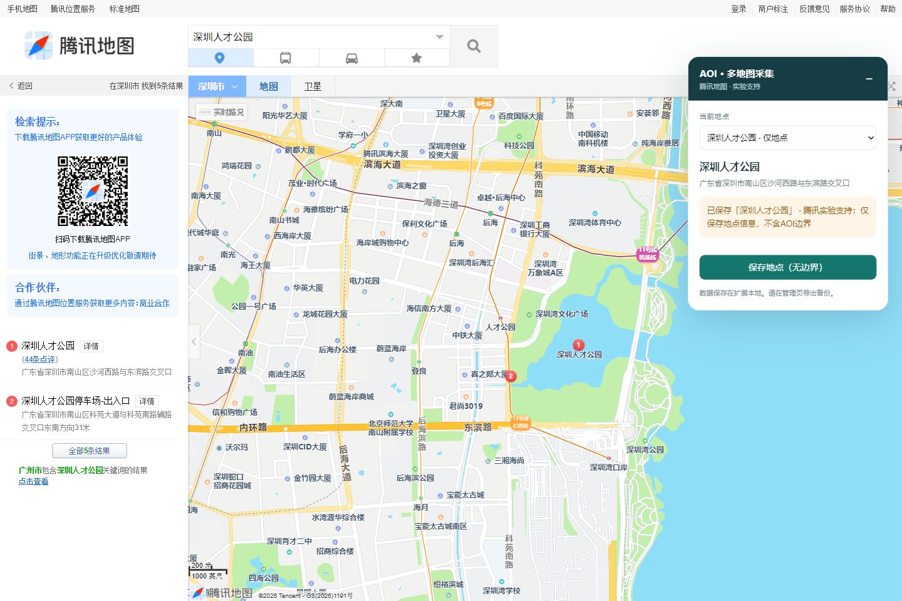

# AOI 多地图采集 · 2.1

一个把地图地点整理成可用数据的本地工具，提供 Chrome / Edge 扩展和 Web 工作台。支持高德、百度的来源边界采集，以及腾讯地图的地点搜索与详情采集。

本项目新增了**百度地图适配、腾讯地图适配**，并重构了高德捕获、三平台坐标处理、预览、备份和导出流程。


## 地图支持

| 地图 | 当前能力 | 本版本说明 |
|---|---|---|
| 高德地图 | AOI 来源边界 | 修复 fetch/XHR 捕获，适配新版网页入口；按地点 ID 关联详情 |
| 百度地图 | AOI 来源边界 | 本项目新增；识别 BD09MC 边界并保留来源精确性标记 |
| 腾讯地图 | 地点搜索、独立详情页采集 | 本项目新增；保留地点 ID、坐标、地址、分类和电话，当前导出 Point |

腾讯仍为实验支持，尚未验证原生 AOI 面。地图没有返回可用轮廓时，工具会明确提示。

## 真实效果

当前演示使用**广州图书馆**和**深圳人才公园**。图片均来自真实网页或实际保存后的工作台，没有修改边界和保存状态。


<details>
<summary>展开查看地图页面的采集效果</summary>

百度地图 · 广州图书馆：


腾讯地图 · 深圳人才公园：



</details>

## 扩展安装

1. 在 [Releases](https://github.com/cloudcollection/aoiCollector-multimap/releases/latest) 下载 extension.zip 并解压。
2. 打开 `edge://extensions/` 或 `chrome://extensions/`，开启开发者模式。
3. 点击“加载已解压的扩展”，选择 `aoiCollectorJs` 文件夹。
4. 刷新地图网页，正常搜索名称、点击具体地点，在右侧浮窗确认名称和来源后保存。
5. 点击扩展图标，打开工作台预览、筛选、备份或导出。

多个结果可在浮窗中手动选择。未返回边界时，不会自动换成另一个地点。腾讯支持从地图搜索页或 `/poi/` 独立详情页保存地点。

## 本地 Web

下载 source.zip 并解压，安装 Python 3.10+ 和 Edge / Chrome。在 Windows 数据盘项目目录运行：

```powershell
.\start.ps1
```

打开 `http://127.0.0.1:9224/`，在工作台点击“打开地图”。独立浏览器中搜索并保存后，回工作台刷新即可查看。扩展与 Web 共用解析、质量提示和管理界面。

可指定端口和临时目录：

```powershell
.\start.ps1 -Port 9224 -TempDir D:\AOI-Temp
```

启动脚本会把依赖缓存、浏览器配置和驱动缓存放到数据盘。手动启动或其他系统：

```bash
python -m venv .venv
# 激活虚拟环境后
pip install -r requirements.txt
# 可设置 AOI_TEMP_DIR、AOI_DATA_DIR、AOI_BROWSER_BINARY
python app.py
```

服务仅监听本机。地图登录或安全验证需要在原网页手动完成；请勿让两个浏览器进程同时使用同一个配置目录。

## 保存与导出

| 功能 | 扩展 | Web |
|---|---|---|
| 本地保存 | IndexedDB | SQLite 和版本化文件 |
| 地图预览、搜索、来源筛选 | ✓ | ✓ |
| GeoJSON、CSV、完整 JSON 备份 | ✓ | ✓ |
| SHP / SHX / DBF / PRJ / CPG 套件 | — | ✓ |

GeoJSON / CSV 统一输出 WGS-84 近似转换坐标。完整备份同时保留原始几何、源坐标系和质量标记。腾讯来源分类与电话保留在备份及 GeoJSON / CSV 中，其编码不会套用高德分类。

记录以“地图来源 + 地点 ID”识别，同名地点不会互相覆盖。Web 再次采集同一 ID 时保留旧文件版本；删除为逻辑删除。扩展删除会移除本地记录，卸载扩展前应先导出完整备份。

旧版扩展的 `aoi_collector/aois` 和 Web 的 `aoi.sqlite/aoi` 会迁移，原仓库 / 原表保留，失败项会提示。不同扩展 ID 之间不能自动访问数据，请先从旧扩展导出备份。

## 来源质量

- 百度广州图书馆实际返回 12 点轮廓，来源 `is_precise=0`；界面和导出保留该提示。来源几何有效不代表测绘准确性。
- 百度当前适配已验证的单环编码。未验证的多环编码会拒绝；规范化与导出层支持经校验的 Polygon / MultiPolygon 和孔洞。
- 腾讯当前提供 Point 地点记录。搜索和独立详情页的真实地标样例均已验证，原生 AOI 面仍待验证。
- 高德 Web 独立浏览器曾遇到人工验证，扩展在线实采、共享解析器和文件导出已分别回归。详细测试范围见 [验证记录](docs/VALIDATION.md)。
- 工作台默认使用本地 WGS-84 坐标网格，显示轮廓、坐标与比例尺；可切换在线底图，服务异常时自动回退网格。

## 开发与验证

```bash
npm ci --ignore-scripts
npm test
pip install -r requirements-dev.txt
python -m pytest -q
```

当前 12 项 Node 与 9 项 Python 回归通过，覆盖真实来源样例、腾讯详情 ID 关联、JS/Python 坐标一致性、孔洞与多面、迁移、同名隔离、导出失败保护和本地 API 访问限制。GitHub Actions 会执行相同回归。

暂存源码后运行 `python scripts/package_release.py`，可生成扩展包、Web 源码包及 SHA-256 校验值。发布包排除数据库、登录配置、依赖环境和缓存。

## 参考仓库

[eqeqeqr/aoiCollector](https://github.com/eqeqeqr/aoiCollector)：参考其原有高德地图采集方案并保留提交历史。**百度地图与腾讯地图适配为本项目新增实现**，并非参考仓库原有能力。

第三方组件及来源许可说明见 [THIRD_PARTY_NOTICES.md](THIRD_PARTY_NOTICES.md)。
