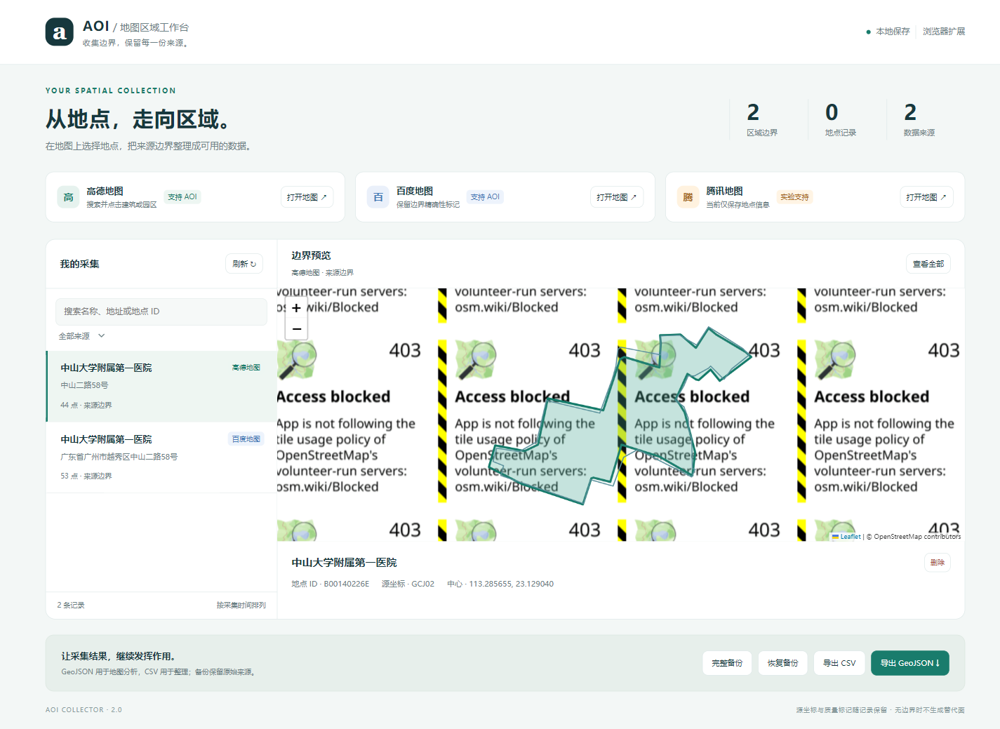
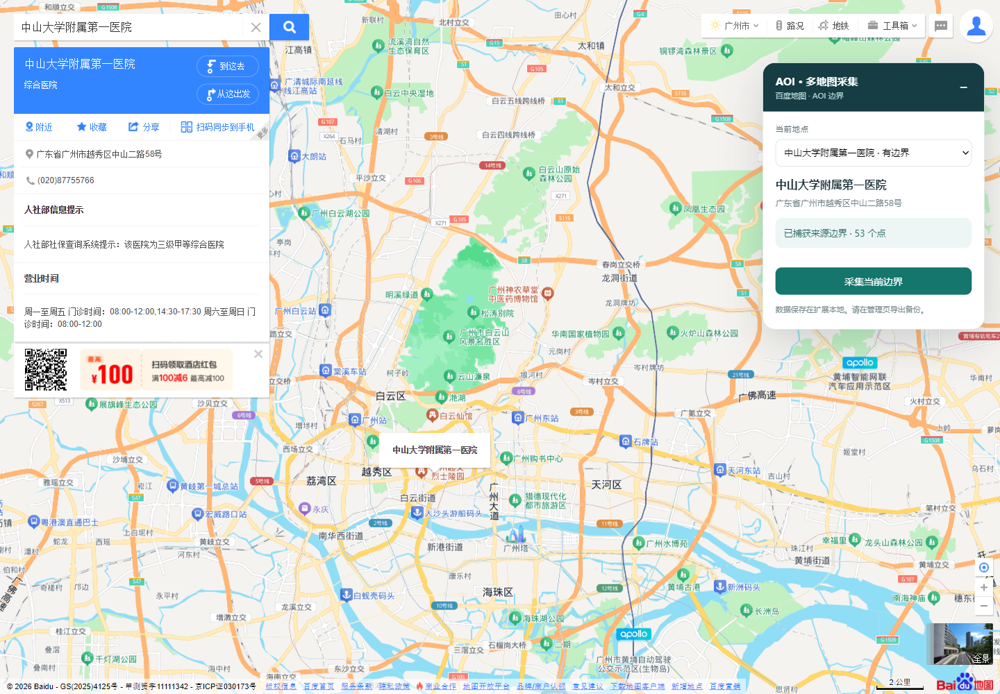
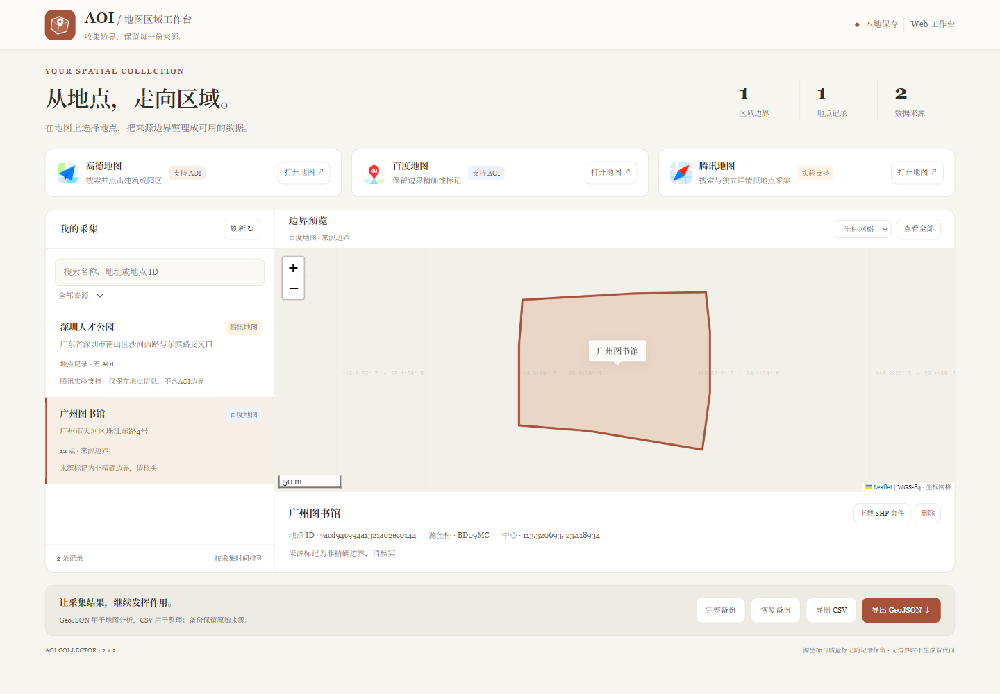

# AOI Atlas

**从高德、百度地图收集地点边界，保留来源，带到 GIS 中继续使用。**

[English](README.md) · [简体中文](README.zh-CN.md)

[下载安装](https://github.com/cloudcollection/aoi-atlas/releases/latest) · [完整使用教程](docs/USAGE.md) · [反馈问题](https://github.com/cloudcollection/aoi-atlas/issues)


整理校园、公园或公共设施的研究范围时，一个地点标记往往不够，你还需要它的轮廓。AOI Atlas 可以把地图页面实际返回的边界保存下来，在本地检查，再导出为 GIS 和表格能使用的数据。

日常采集可以用 **Chrome / Edge 扩展**；需要 Shapefile 时，可以用 **本地 Web 工作台**。腾讯地图目前为实验支持，**只能保存地点 Point，不能采集 AOI 面**。当前软件界面为中文。



## 目录

- [可以用来做什么](#可以用来做什么)
- [地图与功能支持](#地图与功能支持)
- [快速开始](#快速开始)
- [采集第一条边界](#采集第一条边界)
- [使用本地 Web 工作台](#使用本地-web-工作台)
- [会得到哪些结果文件](#会得到哪些结果文件)
- [坐标与数据质量](#坐标与数据质量)
- [常见问题](#常见问题)
- [参与改进](#参与改进)
- [致谢与许可](#致谢与许可)

## 可以用来做什么

- **整理小规模研究区域。** 收集地图中可用的校园、公园、建筑或设施边界，作为调研和制图的输入。
- **为 QGIS / ArcGIS 准备数据。** 导出 GeoJSON；也可以在 Web 工作台下载单条记录的 Shapefile 套件。
- **对比不同地图的来源轮廓。** 保留地图来源、地点 ID、原始几何和质量标记，方便回查。
- **建立地点信息表。** 将名称、地址、中心坐标，以及来源提供的分类、电话等信息导出为 CSV。
- **在扩展与 Web 之间转移采集结果。** 通过完整 JSON 备份保留原始来源，并在另一端恢复。

缓冲区、空间连接、面积计算和正式制图需要在 GIS 软件中完成；本工具负责收集和整理输入数据。

## 地图与功能支持

| 地图来源 | 当前能力 | 使用时需要知道 |
| --- | --- | --- |
| 高德地图 | AOI 边界采集 | 地图页面返回边界时才能保存，并非所有地点都有 AOI。 |
| 百度地图 | AOI 边界采集 | 支持已验证的单环来源编码，保留精确性标记；未验证的多环编码会拒绝。 |
| 腾讯地图 | 实验性 POI 地点采集 | 支持搜索页和独立详情页的地点信息；尚不支持原生 AOI 面。 |

**AOI** 是用多边形表示的区域范围；**POI** 是地点坐标及其属性。工具不会把中心点或包围框生成替代边界。

## 快速开始

推荐先用扩展。准备较新版本的 **Chrome 或 Edge**（Chromium 111+），无需安装 Python 或 Node.js。

1. 打开 [Releases](https://github.com/cloudcollection/aoi-atlas/releases/latest)，在 **Assets** 中下载文件名以 **`-extension.zip`** 结尾的附件，解压到固定位置。
2. 在地址栏打开 `chrome://extensions/` 或 `edge://extensions/`，开启 **开发者模式**。
3. 点击 **加载已解压的扩展**，选择解压后的 **`aoiCollectorJs`** 文件夹，确认其中有 `manifest.json`。
4. 刷新已经打开的地图网页。点击扩展图标，进入工作台。
5. 选择一个地图，按下面的例子完成第一次采集。

安装后请保留解压目录。此方式下载的是 Release 附件中的扩展包。

## 采集第一条边界

可以先在百度地图尝试 **广州图书馆**。这个地点已有真实返回边界的记录；地图响应可能随时间变化。

1. 打开 [百度地图](https://map.baidu.com/)，搜索 **广州图书馆**，点击具体地点结果。
2. 查看网页右侧采集浮窗，确认名称、地址和地图来源。若出现多个候选，手动选择目标地点。
3. 出现来源边界后，点击 **采集当前边界**，等到浮窗提示 **已保存**。
4. 点击扩展图标进入工作台，选中刚保存的记录，检查轮廓和质量提示。
5. 点击 **导出 GeoJSON** 获取空间数据，点击 **导出 CSV** 获取信息表，或点击 **完整备份** 保留完整记录。

广州图书馆的已记录样例带有 `is_precise=0`，表示来源将它标记为非精确边界。使用前请保留并检查这条提示。



若想尝试地点采集，可以在 [腾讯地图](https://map.qq.com/) 搜索 **深圳人才公园**，点击 **保存地点（无边界）**。结果为地点 Point。

Web 采集、备份转移、GIS 导入及故障排查见 [完整教程](docs/USAGE.md)。

## 使用本地 Web 工作台

需要本地文件管理和 Shapefile 时使用这一方式。准备 **Python 3.10+**、**Edge / Chrome**，并确保首次安装依赖、获取浏览器驱动及访问地图时能够联网。

1. 在 [Releases](https://github.com/cloudcollection/aoi-atlas/releases/latest) 下载文件名以 **`-source.zip`** 结尾的附件。
2. Windows 下解压到数据盘，例如 `D:\AOI-Atlas`。进入包含 `start.ps1` 的项目目录，打开 PowerShell。
3. 运行：

   ```powershell
   .\start.ps1
   ```

4. 在浏览器访问 [http://127.0.0.1:9224/](http://127.0.0.1:9224/)。点击 **打开地图**，在新启动的独立浏览器中采集。
5. 搜索、核对并保存地点后，回到工作台点击 **刷新**。
6. 选中记录，点击 **下载 SHP 套件**；也可以在底部导出 GeoJSON、CSV 或完整备份。

首次启动会自动安装 Python 依赖。采集期间保持启动窗口运行；结束时按 `Ctrl+C` 停止服务。已记录的测试环境为 Windows，其他环境的手动启动方法见 [配置说明](docs/USAGE.md#手动启动与配置)。



## 会得到哪些结果文件

| 文件 | 扩展 / Web | 内容与用途 |
| --- | --- | --- |
| `aoi.geojson` | 两者都有 | 全部记录的 WGS-84 FeatureCollection，可用于 QGIS、ArcGIS 或地图程序；可能同时包含边界面和腾讯地点。 |
| `aoi.csv` | 两者都有 | UTF-8 信息表，包含名称、来源、地点 ID、中心坐标、质量提示和 JSON 文本形式的几何。 |
| `aoi-backup.json` | 两者都有 | 完整备份，用于恢复和跨端转移；保留原始几何、源坐标、质量标记及采集时间。 |
| `aoi-files.zip` | Web，当前选中记录 | 包含 `boundary.shp/.shx/.dbf/.prj/.cpg`、`boundary.geojson`、`record.json` 和 `说明.txt`。Shapefile 的配套文件需要放在一起。 |

**搜索和来源筛选只改变列表；GeoJSON、CSV 和完整备份导出包含全部已保存记录。** SHP 按钮下载当前选中的单条记录。

扩展与 Web 各自保存本地采集结果，不会自动同步。需要转移时，导出完整备份，再到另一端恢复。

字段含义、目录结构和几何类型说明见 [结果文件参考](docs/OUTPUTS.zh-CN.md)。

## 坐标与数据质量

- 导出几何和中心坐标统一使用 **WGS-84，经度在前、纬度在后**。GCJ-02、百度坐标到 WGS-84 的转换为近似转换。
- `SOURCE_CRS` 表示**原始来源坐标系**，不是导出文件的坐标系。
- 来源轮廓可能表示整个场所，而不是单栋建筑。几何有效或带有精确性标记，都不代表测绘精度或法定边界。
- 计算面积、距离前，应在 GIS 中选用适合研究区域的投影坐标系。用于研究前请核对地点关联和来源轮廓。
- 采集取决于地图页面实际返回的信息。登录或人工验证需要在原网页完成，数据使用应遵守地图服务方的条款。

## 常见问题

**保存按钮为什么不可用？**

先搜索并点击具体地点。页面没有返回受支持的边界时，就没有可保存的 AOI。详见 [故障排查](docs/USAGE.md#故障排查)。

**腾讯为什么只有一个点？**

当前支持的就是地点记录，搜索结果的范围框不会作为 AOI 保存。

**预览为什么是一张网格？**

默认使用本地 WGS-84 坐标网格。可切换在线底图；底图服务不可用时会自动回到网格。

**同名地点会不会互相覆盖？**

记录通过 **地图来源 + 地点 ID** 区分。同一来源、同一 ID 再次保存时更新当前记录；Web 还会保留以前的输出文件夹。

**更换浏览器或重装扩展，如何保留结果？**

先导出 **完整备份**。不同扩展 ID 或浏览器配置无法自动读取旧数据。恢复每个文件最多接受 **500 条记录、20 MB**；更大的集合请按 [备份与转移](docs/USAGE.md#备份与转移) 处理。

## 参与改进

欢迎反馈地图兼容问题、补充教程、改进翻译或提交解析修复。[提交 Issue](https://github.com/cloudcollection/aoi-atlas/issues) 时，写明地图来源、公开地点名称或 ID、期望结果与实际表现。附件请移除 Cookie、令牌及私人浏览器数据。

本地检查和参与方式见 [CONTRIBUTING.md](CONTRIBUTING.md)。如果工具帮到了你，也欢迎点一颗 Star，让有同样需要的人更容易找到它。

## 致谢与许可

本项目复用了 [eqeqeqr/aoiCollector](https://github.com/eqeqeqr/aoiCollector) 的部分代码和资源，并在此基础上继续维护高德采集功能。百度与腾讯适配、共享数据模型、工作台、迁移及版本化输出由本项目新增。

各组件的许可与署名见 [第三方声明](THIRD_PARTY_NOTICES.md)。地图数据及商标权利仍适用其权利人的条款。
